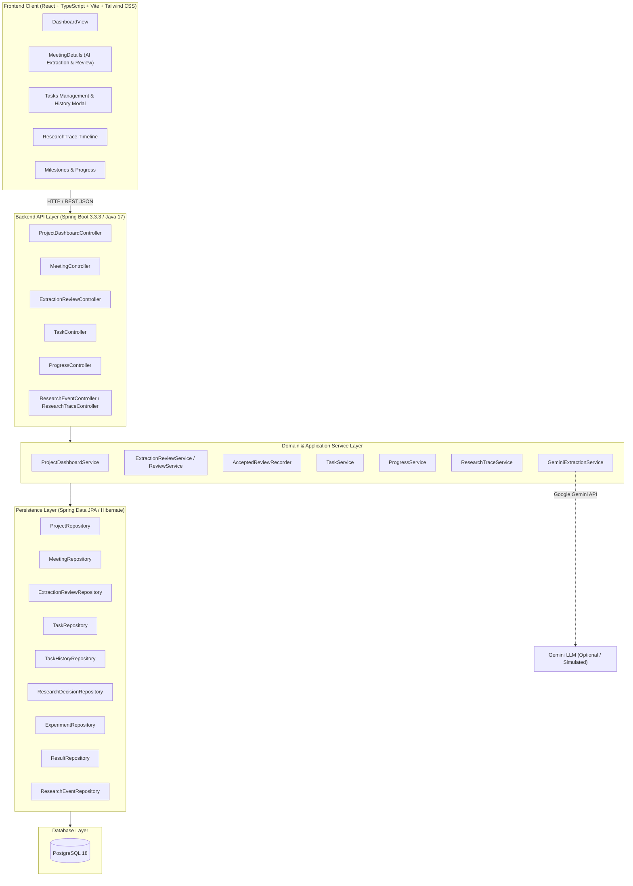
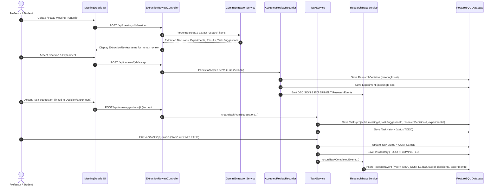
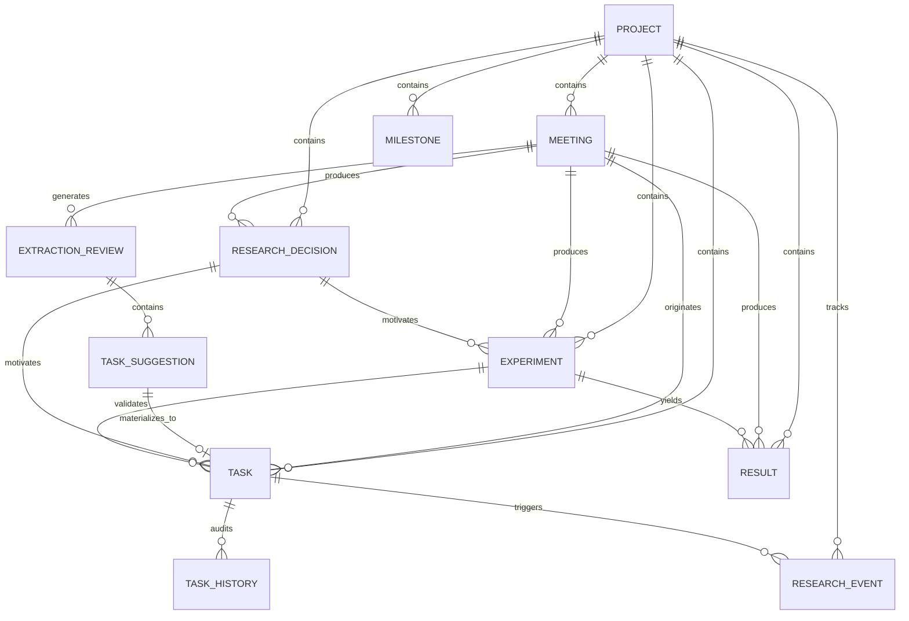

# ResearchTrace Architecture

This document describes the architectural design, component interactions, data flow, schema modifications, and operational boundaries of the ResearchTrace platform following the Stage 2 implementation.

---

## 1. System Overview

ResearchTrace is an academic research supervision and tracking platform that connects meeting discussions, research decisions, experiments, tasks, and student progress into a coherent, auditable chronological timeline.

### High-Level Architecture Diagram

---

## 2. Modules and Responsibilities

ResearchTrace separates concerns into modular, decoupled subsystems:

1. **Project Management & Collaboration (`com.researchtrace.project`)**:
   - Manages projects, project members, users, and milestone hierarchies.
   - Enforces project boundaries and member authorization.

2. **Meeting Supervision & AI Extraction (`com.researchtrace.meeting`, `com.researchtrace.extraction`)**:
   - Ingests supervision meeting transcripts, notes, and metadata.
   - Orchestrates AI-assisted extraction of research decisions, experiments, results, and action items via `GeminiExtractionService`.
   - Provides human-in-the-loop review workflow (`ExtractionReview`, `ExtractionReviewItem`) allowing supervisors/students to accept, edit, or reject AI suggestions.
   - Commits accepted items atomically to canonical research and task entities via `AcceptedReviewRecorder`.

3. **Task & Lifecycle Management (`com.researchtrace.task`)**:
   - Manages actionable tasks assigned to project members.
   - Tracks rich provenance: originating meeting (`meetingId`), suggestion reference (`taskSuggestionId`), motivating research decision (`researchDecisionId`), and experiment (`experimentId`).
   - Records an immutable, transactional lifecycle history (`TaskHistory`) on every state transition.
   - Emits research timeline events (`TASK_COMPLETED`) when research-linked tasks finish.

4. **Progress Derivation Engine (`com.researchtrace.progress`)**:
   - Calculates strictly project-isolated progress percentages.
   - Derives individual student progress (`completed / total assigned tasks`).
   - Derives milestone progress dynamically without storing mutable progress flags on milestones.
   - Computes weighted project progress combining milestone weights with unassigned/milestone-less tasks.

5. **Research Traceability & Dashboard (`com.researchtrace.research`, `com.researchtrace.dashboard`)**:
   - Maintains the chronological research event log (`ResearchEvent`, `ResearchEventType`).
   - Surfaces unified project health and research activity metrics (`ResearchMetrics`).

---

## 3. End-to-End Research Trace Flow

The central value proposition of ResearchTrace is the unbroken provenance trail from spoken meeting dialogue to completed engineering and research tasks.

---

## 4. Stage 2 Domain Entities & Schema Changes

Stage 2 enriched the data model to establish bi-directional traceability between project management and scientific artifacts.

### 4.1 Schema Evolution (Hibernate `update` Mode)

All schema changes were performed non-destructively using backward-compatible, nullable additions:

| Table | Modified / Added Column | Type | Constraints / Purpose |
|---|---|---|---|
| `task` | `project_id` | `BIGINT` | References `project(id)`. Ensures tasks are project-scoped. |
| `task` | `meeting_id` | `BIGINT` | Nullable foreign key to originating `meeting(id)`. |
| `task` | `task_suggestion_id` | `BIGINT` | Nullable link to source `task_suggestion(id)`. |
| `task` | `research_decision_id` | `BIGINT` | Nullable link to motivating `research_decision(id)`. |
| `task` | `experiment_id` | `BIGINT` | Nullable link to motivating `experiment(id)`. |
| `task` | `created_at` | `TIMESTAMP` | Record creation audit timestamp. |
| `task` | `updated_at` | `TIMESTAMP` | Record last-updated audit timestamp. |
| `task_suggestion` | `research_decision_id`| `BIGINT` | Suggestion-stage link to research decision. |
| `task_suggestion` | `experiment_id` | `BIGINT` | Suggestion-stage link to experiment. |
| `experiment` | `meeting_id` | `BIGINT` | Originating meeting provenance. |
| `result` | `meeting_id` | `BIGINT` | Originating meeting provenance. |
| `research_event` | `task_id` | `BIGINT` | Nullable link to originating `task(id)`. |
| `task_history` | *New Table* | — | `id (BIGINT PK)`, `task_id (BIGINT)`, `previous_status (VARCHAR)`, `new_status (VARCHAR)`, `changed_by_user_id (BIGINT)`, `changed_at (TIMESTAMP)`. |

### 4.2 Entity Relationship Diagram (Stage 2)

---

## 5. Transaction & Consistency Boundaries

1. **Task Status Transition & History**:
   - `TaskService.updateTaskStatus(...)` is marked `@Transactional`.
   - Modifying a task's status persists the updated task, inserts a `TaskHistory` record, and (if linked to research and transitioning to `COMPLETED`) creates a `ResearchEvent`.
   - If any insert fails (e.g., event persistence failure), the entire transaction rolls back cleanly, leaving no orphaned history or corrupted status.

2. **Idempotency & Duplicate Prevention**:
   - Repeated completion calls on an already completed task are detected (`previousStatus == newStatus`), bypassing redundant history creation and duplicate timeline events.
   - For review acceptance, `ResearchReviewClaim` with SHA-256 idempotency tokens prevents duplicate record creation across repeated review submissions.

3. **Cross-Project Isolation**:
   - `TaskService` validates that assigned users, milestones, research decisions, and experiments belong to the exact same project as the task. Cross-project links are rejected with `IllegalArgumentException`.
   - `ProgressService` scopes all task and milestone queries strictly by `projectId`, ensuring tasks from one project cannot leak into or distort another project's progress.

---

## 6. Known Architectural Limitations & Future Work

1. **User Identity Attribution (`changedByUserId` / `createdByUserId`)**:
   - The current MVP does not yet run an integrated Spring Security / OAuth2 filter chain.
   - User IDs are caller-provided payload parameters rather than cryptographically verified session identities. While audit records accurately capture the declared identity, production deployment will replace this with `SecurityContextHolder` extraction.
2. **Frontend Test Framework**:
   - The frontend codebase currently relies on strict TypeScript type-checking (`tsc -b`) and Vite production bundling (`vite build`) for verification. A dedicated UI test runner (e.g. Vitest + React Testing Library) is slated for Stage 3.
3. **Database Migration Strategy**:
   - The development environment uses Hibernate's `ddl-auto=update`. For formal production rollout, a Flyway or Liquibase migration pipeline should manage declarative SQL scripts.
